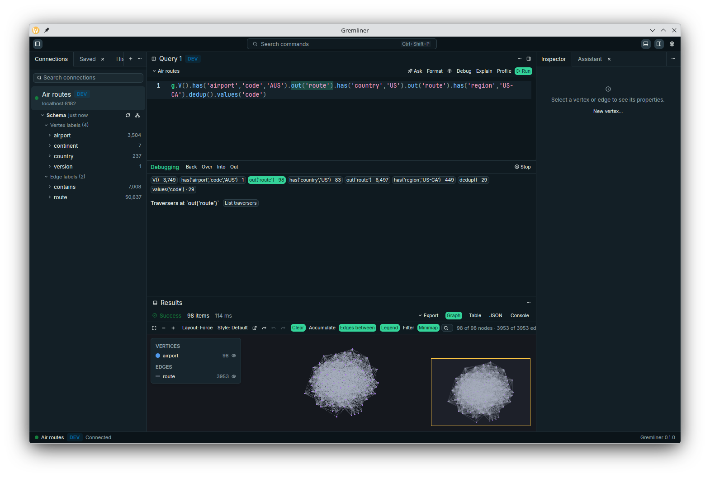
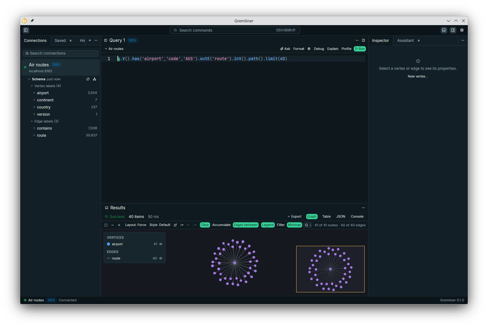
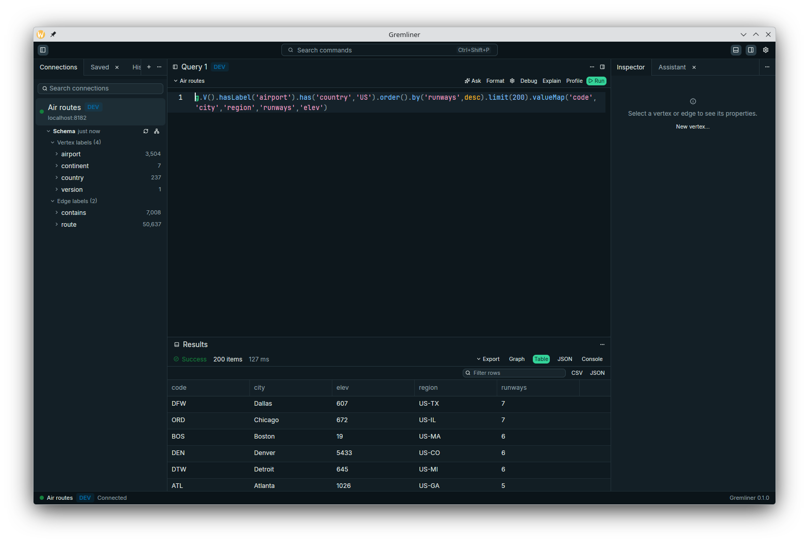
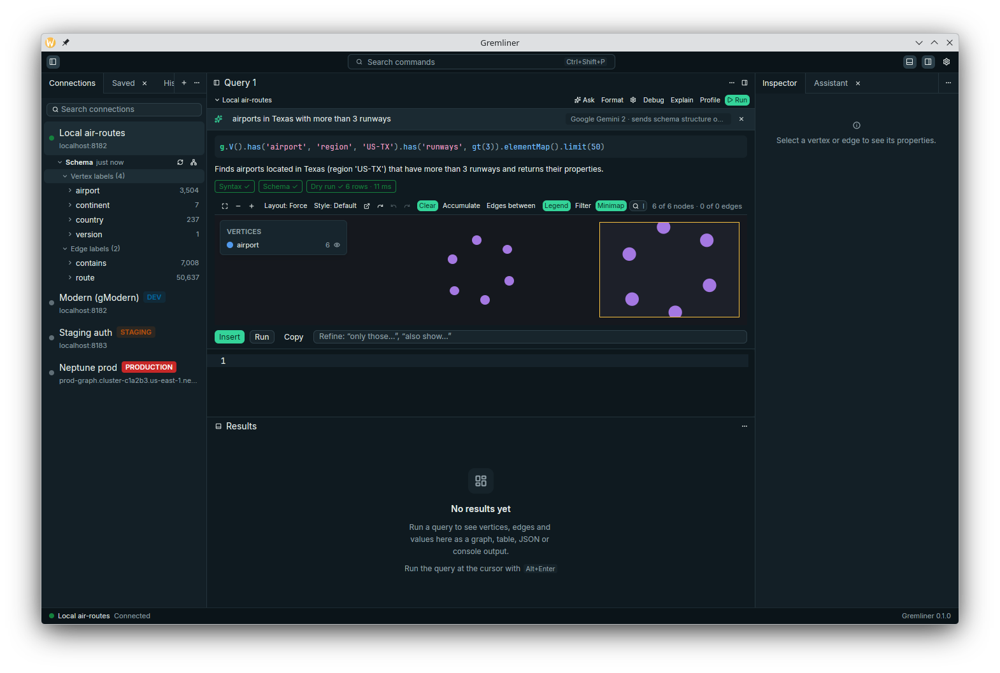
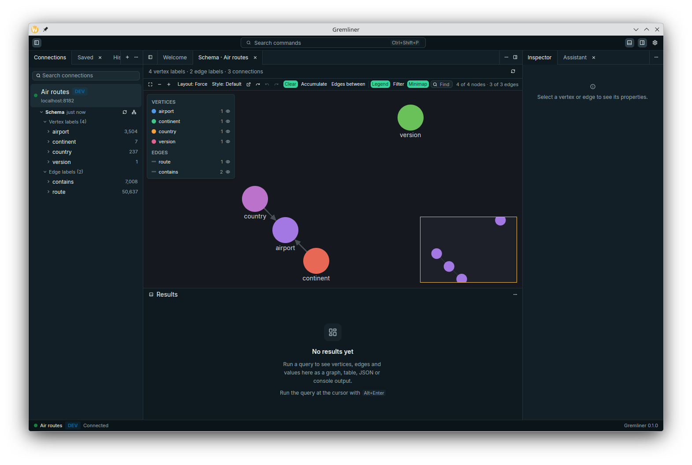
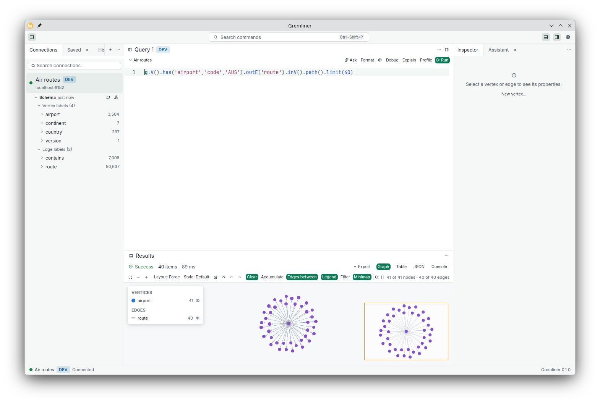
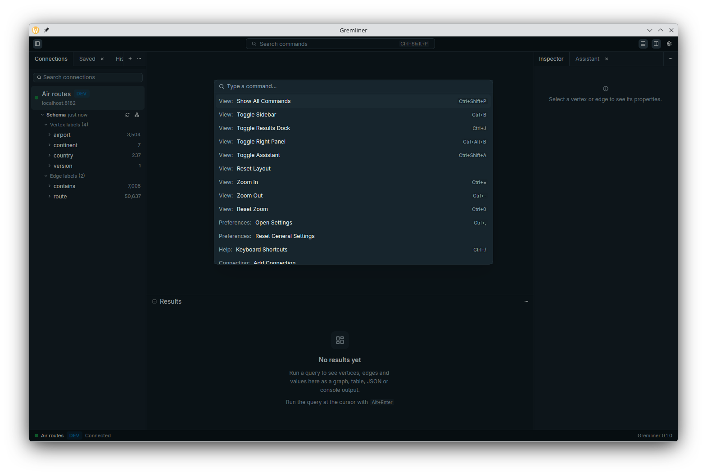

<div align="center">

# Gremliner

**A fast, native desktop IDE for Gremlin.**
Write, run, visualise and step-debug [Apache TinkerPop](https://tinkerpop.apache.org/) traversals against
Gremlin Server or Amazon Neptune, with an AI assistant that checks every query against your real schema before
you see it.

[](https://github.com/szehnder/gremliner-ide/actions/workflows/ci.yml)
[](https://github.com/szehnder/gremliner-ide/releases/latest)


**[Download for macOS, Windows or Linux](https://github.com/szehnder/gremliner-ide/releases/latest)**



</div>

## Why Gremliner

- **Native and fast.** Pure Rust with a GPU-rendered UI ([GPUI](https://www.gpui.rs/)). No Electron, no JVM.
  It reaches the first frame in about 0.2 s, idles at about 110 MB, and draws 50,000-node graphs at 60+ fps.
  Every one of those numbers is a budget that CI enforces.
- **A real debugger for traversals.** Step over, into, out of and *back through* a Gremlin query. See how many
  traversers survive each step, and where a single traverser drops out.
- **AI you can trust with production.** Describe what you want in plain English. The query you get back has
  already been parsed, checked against your schema and test-run **read-only** with a limit. The assistant
  never runs a mutation.
- **Any model, including local ones.** Anthropic, Google Gemini, OpenAI, OpenRouter and vLLM, or run fully
  offline with Ollama or LM Studio.
- **Neptune-ready.** IAM (SigV4) from your AWS profiles and SSO, Neptune profile and explain output, schema
  from the statistics API, and LocalStack.
- **Private by default.** No telemetry. Passwords and API keys live in your OS keychain. Sample data is only
  ever sent to a cloud model when you switch it on for that connection.

## Features

### Graph view
GPU-drawn graph with level of detail, a minimap, lasso selection, hide and pin, and *expand neighbours*.
Choose force-directed (ForceAtlas2), hierarchical, radial, circular, grid or concentric layouts.
Style each label with its own colour, size, icon and caption, and save the styles as named stylesheets.
Create, edit and delete vertices, edges and properties, with undo.



### Editor that knows your graph
Gremlin highlighting with diagnostics as you type, and completion for steps, labels, property keys and
values from the discovered schema. Hover docs for every step and a Gremlint-style formatter.
Run the statement at the cursor with `Alt+Enter`; `$name` parameters become typed inputs sent as bindings.



### Results your way
Graph, table (sortable, filterable, 100k rows scroll smoothly), JSON tree and console.
Profile and explain views with per-step timing bars, for TinkerPop and Neptune.
Export graphs as PNG, SVG, GraphML or GraphSON, and results as CSV, JSON or JSON Lines.

### Step-through debugger
`Ctrl+F5` starts a session; `F10`/`F11`/`Shift+F11`/`F9` step over, into, out and back.
Traverser counts appear inline next to each step. Inspect a single traverser to see where it stops matching.
Steps that can't be debugged say why instead of failing silently. The screenshot at the top of this page
is a debug session paused at `out('route')`: 98 traversers left, drawn as a graph.

### Schema-checked assistant
Press `Ctrl+K` in the editor and ask *"airports in Texas with more than 3 runways"*.
Gremliner builds a compact schema summary, gets a query from your model, validates it, test-runs it read-only,
repairs it if needed, and shows the result card: ✓ syntax ✓ schema ✓ test run, with a preview.
Then Insert, Run or Refine it. The assistant panel also explains queries, fixes errors, suggests optimisations
from profile output and describes results.



### Explore without writing Gremlin
A no-code path builder with typed filters that generates the Gremlin for you, and a schema graph of how your
labels connect.



### Everyday comforts
History you can search, saved queries in folders, tabs that survive a restart, light and dark themes, a command palette
(`Ctrl+Shift+P`) and a shortcuts sheet (`Ctrl+/`). Keyboard navigation and screen-reader names throughout,
and a reduce-motion setting that follows your OS.

| Light theme | Command palette |
|---|---|
|  |  |

## Download

Installers are on the [Releases page](https://github.com/szehnder/gremliner-ide/releases/latest). You don't
need Rust or any developer tools.

| System | File | |
|---|---|---|
| macOS 11+ (Apple silicon and Intel) | `Gremliner-<version>-macos-universal.dmg` | Open it and drag Gremliner to Applications |
| Windows 10/11 (x64) | `Gremliner-<version>-windows-x86_64-setup.exe` | Installs for your user; no admin rights |
| Linux, any distro (x64) | `Gremliner-<version>-linux-x86_64.AppImage` | `chmod +x` it, then run it |
| Debian, Ubuntu (x64) | `Gremliner-<version>-linux-x86_64.deb` | `sudo apt install ./Gremliner-<version>-linux-x86_64.deb` |
| Anything else | `.tar.gz` / `.zip` | Both programs, ready to run |

Every package has the desktop app (`gremliner`) and the [headless CLI](#headless-cli) (`gremliner-cli`), plus a
`.sha256` checksum beside it.

**First launch.** The builds aren't code-signed yet, so you'll see a warning once:

- **macOS:** right-click Gremliner in Applications and choose **Open**. If that doesn't help, go to
  **System Settings → Privacy & Security** and click **Open Anyway**, or run
  `xattr -dr com.apple.quarantine /Applications/Gremliner.app`.
- **Windows:** SmartScreen says it "protected your PC". Click **More info → Run anyway**.

**Requirements.**
- Linux needs glibc 2.35 or newer (Ubuntu 22.04+, Debian 12+, Fedora 36+) and a Vulkan driver.
- x86_64 needs a CPU from about 2009 or later ([x86-64-v2](docs/adr/0031-x86-64-v2-baseline.md)).

**Something to connect to.** If you don't have a Gremlin database at hand, start TinkerPop's server with its
small sample graph and connect to `ws://localhost:8182/gremlin`:

```sh
docker run -p 8182:8182 tinkerpop/gremlin-server:3.7.3 conf/gremlin-server-modern.yaml
```

## Build from source

For contributors, or to try the larger demo with air-routes:

```sh
git clone https://github.com/szehnder/gremliner-ide && cd gremliner-ide
cargo xtask doctor   # checks your toolchain and system libraries, and says how to fix what's missing
cargo xtask demo     # starts a sample Gremlin Server in Docker and opens Gremliner connected to it
```

`demo` needs Docker. It starts `tinkerpop/gremlin-server` with the
[air-routes](https://github.com/krlawrence/graph) graph (3,504 airports, 50,637 routes) on `localhost:8182`,
saves an *Air routes (demo)* connection and opens the app on a first query. The first build takes a few minutes.
Stop the server with `cargo xtask testenv down`.

### Prerequisites

| | |
|---|---|
| **Rust** | Install [rustup](https://rustup.rs). The pinned toolchain in `rust-toolchain.toml` downloads automatically on the first build. |
| **Linux** | A C compiler, `pkg-config`, and the dbus, xcb and xkbcommon headers (below). Wayland and X11 both work. |
| **macOS** | Xcode command line tools: `xcode-select --install`. |
| **Windows** | The MSVC build tools that rustup offers to install. |
| **Docker** | Optional: for `cargo xtask demo` and the integration tests. |

Linux packages:

```sh
sudo apt install build-essential pkg-config libdbus-1-dev libxcb1-dev libxkbcommon-dev libxkbcommon-x11-dev   # Debian, Ubuntu
sudo dnf install gcc pkgconf-pkg-config dbus-devel libxcb-devel libxkbcommon-devel libxkbcommon-x11-devel    # Fedora
sudo pacman -S base-devel dbus libxcb libxkbcommon libxkbcommon-x11                                          # Arch, Manjaro
```

You also need a Vulkan driver, which every desktop distribution ships (Mesa for AMD and Intel, or NVIDIA's).

### Build and run

```sh
cargo run --release -p gremliner                                  # the app
cargo build --release -p gremliner && ./target/release/gremliner  # or build once, run the binary
```

Use `--release`: debug builds work, but the graph canvas and editor are much slower.

### Connect to your own database

Click **Add connection** on the welcome screen, or press `Ctrl+Shift+P` and pick *Add Connection*.

| Database | What to enter |
|---|---|
| **Gremlin Server** (TinkerGraph, JanusGraph and others that speak the Gremlin Server protocol) | `ws://host:8182/gremlin` (or `wss://`), with an optional username and password |
| **Amazon Neptune** | The cluster endpoint. Region comes from the hostname, credentials from your AWS profile, SSO or environment. To reach a VPC from your machine, open an SSH or SSM tunnel and enter its `localhost:port` as the tunnel. |
| **Neptune on LocalStack** | The LocalStack edge URL plus the cluster id; the cluster's port is looked up on every connect. |

Mark a connection **read-only** and Gremliner refuses to run mutations on it. Tag it dev, staging or production
and the tag shows wherever the connection does, with production in red.

### Set up the AI assistant

Open **Settings → AI** (`Ctrl+,`) and add a profile:

| Provider | Notes |
|---|---|
| **LM Studio** | Start the local server (Developer tab), load a model, and pick the *LM Studio* preset (`http://localhost:1234/v1`). |
| **Ollama** | `ollama pull qwen2.5-coder` (or any model), then pick the *Ollama* preset (`http://localhost:11434/v1`). |
| **Anthropic, Gemini, OpenAI, OpenRouter** | Paste an API key; it goes to your OS keychain. |
| **Anything OpenAI-compatible** (vLLM, LiteLLM, ...) | The *Custom* preset with a base URL. |

Models for each provider are fetched from it. Choose which profile each connection uses, and whether it may
see sample values, on the same page.

Expect very different speeds: on the laptop the screenshots were made on, a 9B model in LM Studio takes about
two minutes per answer and Gemini Flash about seven seconds. Small local models also follow vague wording less
well (asked for "airports in Texas", one returned every US airport); the schema and test-run checks catch
invalid queries, but not a valid query that answers a different question, so read the explanation on the card.

## Headless CLI

Everything that doesn't need a window is also a command, and the CLI shares saved connections and AI profiles
with the app. It's useful in scripts and CI, and for AI coding agents.

```sh
cargo run --release -p gremliner-cli -- query --url ws://localhost:8182/gremlin "g.V().has('code','AUS').out().values('city')"
gremliner-cli schema --conn "Air routes (demo)"                 # labels, typed properties, counts, connections
gremliner-cli nl --conn "Air routes (demo)" "airports in Texas with more than 3 runways"   # → checked query
gremliner-cli lint query.groovy && gremliner-cli fmt query.groovy
gremliner-cli profile --conn prod "g.V().hasLabel('user').out('follows').count()"
```

Also: `explain`, `parse --json`, `connections`, `llm`, `layout-bench`, `render-bench`. Run `gremliner-cli --help`.

## Keyboard shortcuts

`Ctrl` is `Cmd` on macOS. Press `Ctrl+/` in the app for the full list.

| | |
|---|---|
| `Ctrl+Shift+P` / `F1` | Command palette |
| `Alt+Enter` / `Ctrl+Enter` | Run the statement at the cursor |
| `Ctrl+Shift+Enter` | Profile it |
| `Esc` | Cancel the running query |
| `Ctrl+K` | Ask the assistant (prompt bar) |
| `Shift+Alt+F` | Format |
| `Ctrl+F5`, `F10`, `F11`, `Shift+F11`, `F9` | Debug: start, step over, into, out, back |
| `Ctrl+T` / `Ctrl+S` | New query tab / save query |
| `Ctrl+B` / `Ctrl+J` / `Ctrl+Shift+A` | Toggle sidebar / results / assistant |
| `F`, `E`, `N`, `Del` (in the graph) | Fit, expand selection, select neighbours, hide |

## Performance

Budgets live in [`perf-budgets.toml`](perf-budgets.toml) and are checked by `cargo xtask bench --check`.
CI fails a pull request that is more than 15% slower than `main`.
Measured on a Ryzen laptop with integrated graphics:

| | Measured | Budget |
|---|---|---|
| Launch to first frame | ~0.2 s | 0.3 s |
| Memory at idle | ~110 MB | 150 MB |
| Graph frame, 10k nodes / 20k edges | 8.3 ms (120+ fps) | 8.3 ms |
| Graph frame, 50k nodes / 100k edges | 13 ms (75 fps) | 16.7 ms |
| Air-routes force layout, settled | 0.44 s | 2 s |
| Diagnostics after a keystroke | 0.4 ms | 8 ms |
| Completion list | 0.4 ms | 30 ms |
| Decoding a 10 MB result | 55 ms | 60 ms |
| Scrolling a 100k-row table, per frame | 2.9 ms | 16 ms |

## Troubleshooting

- **`cargo build` fails in a `-sys` crate on Linux.** Run `cargo xtask doctor`; it names the missing package.
- **Hybrid-graphics laptop (integrated + NVIDIA).** Gremliner renders on the GPU your compositor uses and skips
  loading NVIDIA's drivers when the display isn't on them, which saves about 100 MB and keeps the discrete GPU
  asleep ([ADR-0039](docs/adr/0039-hybrid-gpu-driver-selection.md)). Set `GREMLINER_GPU=all` to turn that off.
- **"Passwords will be kept for this session only".** No Secret Service is running (some minimal Linux
  setups). Install and unlock `gnome-keyring` or KWallet, or set `GREMLINER_SECRET_STORE=memory` to silence it.
- **The demo can't connect.** Check `cargo xtask testenv status`. Port 8182 must be free.
- **The AppImage won't start** and mentions FUSE. Install `libfuse2` (`libfuse2t64` on Ubuntu 24.04), or run it
  with `--appimage-extract-and-run`.
- **macOS says the app is damaged, or Windows says it protected your PC.** The builds are unsigned; see
  [First launch](#download).
- **Start over.** Pass `--data-dir /some/empty/dir` (app and CLI), or `--no-persist` (app) for a throwaway session.

## Status

Version 0.1. All the features above are implemented and covered by tests. Linux is the primary platform
(daily use on KDE Plasma, Wayland). macOS and Windows build in CI but have had less hands-on use.
Installers for all three platforms are on the [Releases page](https://github.com/szehnder/gremliner-ide/releases);
they are not code-signed yet. Not yet supported: GraphBinary, JanusGraph-specific and Cosmos DB providers,
openCypher, and SSH tunnels managed by the app.

## Contributing

The project is spec-driven and written to be worked on by people and AI coding agents alike:

| Path | What |
|---|---|
| [`AGENTS.md`](AGENTS.md) | How to work in this repo: layering rules, workflow, commands |
| [`docs/adr/`](docs/adr/README.md) | 40 architecture decisions, one per file |
| [`openspec/specs/`](openspec/specs/) | The behaviour of every capability, as requirements and scenarios |
| [`openspec/ROADMAP.md`](openspec/ROADMAP.md) | The order features were built in |
| [`docs/gpui-notes.md`](docs/gpui-notes.md) | Hard-won notes on GPUI and gpui-kit |
| `crates/` | Core (no I/O), I/O and UI crates ([ADR-0004](docs/adr/0004-layered-cargo-workspace.md)) |

Every `#### Scenario:` in a spec has a test named after it, and CI checks that none is missing.

```sh
cargo xtask ci                                   # fmt, clippy, layering, design tokens, tests, spec checks
cargo xtask testenv up && cargo xtask testenv seed  # Docker servers the integration tests use
cargo xtask bench --check                        # performance budgets (opens windows: keep them visible)
cargo xtask screenshot --all-surfaces            # light and dark screenshots of every surface
cargo xtask package --docker                     # Linux installers into target/packages (macOS: --universal)
```

### Releasing

Installers are built by CI ([ADR-0040](docs/adr/0040-installers-with-cargo-packager.md),
[`release.yml`](.github/workflows/release.yml)). To publish one, set `version` in the root `Cargo.toml`, commit,
then push a matching tag:

```sh
git tag v0.2.0 && git push origin v0.2.0
```

CI builds the macOS, Windows and Linux packages and creates the GitHub Release with
[these notes](packaging/release-notes.md). Running the workflow by hand from the Actions tab builds the same
packages as downloadable artifacts, without publishing anything.

## License

[Apache-2.0](LICENSE)
